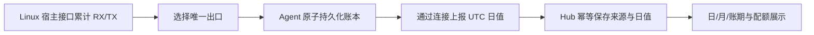

# 独立开发方案与首版边界

## 已采用的方向

项目使用独立仓库、产品版本与发布流程，保留 Beszel/Beszel+ 的许可和来源说明。不再以自动跟随上游、反复重放补丁为开发方式；未来可按需要人工评估安全修复。旧项目的数据、身份密钥与 vnStat 历史不作为新版输入，新安装从空数据目录开始。

首版面向 Linux VPS：CPU、内存/交换区、磁盘/IO、负载、网络、Docker、在线状态、告警和流量配额。温度、风扇、电池、Wi-Fi 不再默认采集，GPU/SMART 不默认启用。暂时保留部分复用代码和协议类型，不以一次性删除所有继承代码为发布前提。

## 原生流量路径

Agent 运行在宿主网络中，直接读取内核累计计数，不依赖宿主 vnstatd、CLI、配置文件或外部数据库。安装配置默认开启原生计量和七天资源缓存。`doctor` 检查实际 Docker 网络模式、持久卷、进程与账本新鲜度，环境变量中的 host 标记不能替代宿主网络。

默认从最低 metric 的有效 IPv4 默认路由选择一个出口，排除 Docker、veth、回环和常见隧道接口。不会把物理口、网桥和其子接口的计数相加。IPv6-only 或无法唯一判断时要求显式选择宿主出口；复杂路由暂不自动推断。

第一次观察只保存基线，不将安装前的开机总量计入账期。基线、来源 UUID、日值与最后时间在同一原子文件中提交；正常更新和容器重启保留该卷。检测到内核计数复位、宿主重启、时钟倒退或写盘失败时显式标记或暂停，避免把异常解释为零用量。

每 30 秒保存一次，UTC 日值最多保留 400 天，与主机系统时区无关。正常跨日采样以区间终点归日，存在采样粒度的误差。同日停采后，内核计数连续时可恢复累计差额；长时间停采跨日的差额保存在本地未分配量中，相关日值标为不完整，暂不在 Hub 自动分摊。不能从日值准确还原任意时区的午夜账期，亦不承诺与云厂商计费完全相等。

## 七天离线资源缓存

资源指标与流量账本相互独立。Agent 每分钟保存资源/容器快照，在时间和容量预算内保留最近七天，默认容量上限 256 MiB。大量容器可能先触及容量限制，不能将“七天”解释为任何负载下无限容量保证。

Hub 恢复连接后按游标分页读取并补齐历史，在同一数据库事务中写入样本、聚合和游标。重复请求不会重复计数，历史补传不触发实时告警。Agent 未运行时不能生成资源样本；Hub 离线但 Agent 持续运行时仍可记录并在恢复后补传。

## 安装与后续发布

源码开发保留 Compose 和 `vpsmonitorctl`。测试版使用 GitHub Container Registry 的固定版本镜像；发行版 Hub 生成同标签的 Agent 安装配置，源码版 Hub 仍生成源码构建配置。

每次发布单独构建 Linux amd64/arm64 镜像并核对标签与源码。正式生产验收仍需要实际 VPS 长期采样、网络和存储故障演练，以及计费口径核对。操作步骤见 [安装维护指南](DEPLOY.md)，发布步骤见 [发布流程](RELEASING.md)。
