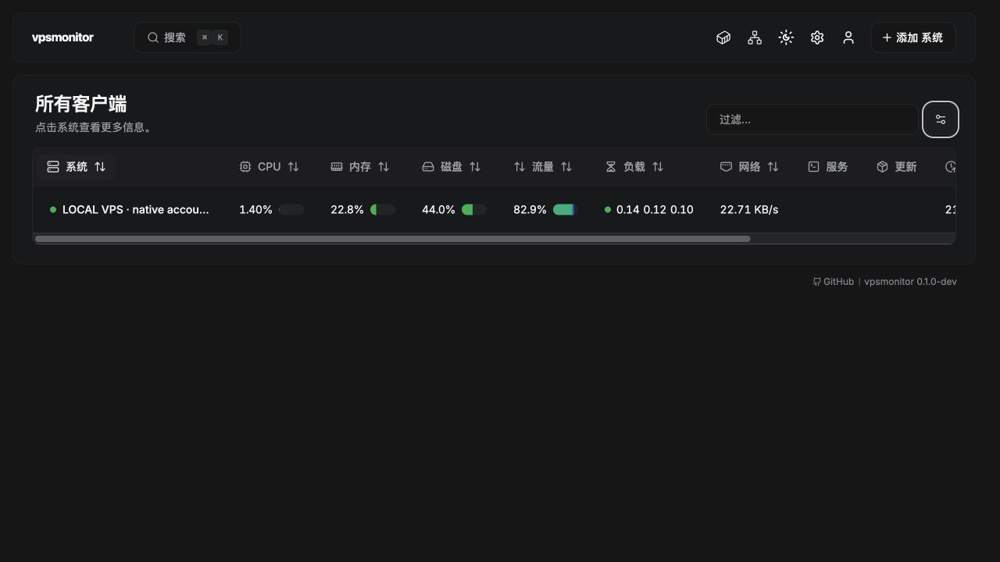

# 0.1.0-dev 验证记录

日期：2026-11-07（北京时间）。功能源码：`c0b246d150cc729dd91e037bdf22f7a5ee8a4659`。这是独立项目的首个开发版，不是生产稳定发布；本轮未重新部署真实 VPS。

## 已验证

- 原生账本：安装时只建基线；同日差额、跨重启续计、重复观察、零流量、写失败回滚、并发写锁、损坏文件拒绝、宿主重启/计数复位、UTC 日期、跨日停采未分配量、400 天留存，以及超过 JavaScript 安全整数的内核基线。
- 网口选择：19 个接口中自动排除 veth/Docker 等并选择默认出口；多个出口需要显式选择；bond 可选；缺失接口报错，不把所有接口叠加。
- Hub：首次上报唯一出口自动选择；人工停用不会被后续上报覆盖；已入库日值在计数不变时也可补上不完整标记；重复上报仍幂等。沿用的身份、权限、告警、配置导入导出与七天资源缓存有原有回归。
- 前端：42 项测试、TypeScript 检查与生产构建通过，中文页面完成了人工验收；其他语言未逐项审校。安装配置覆盖宿主网络、持久卷、主动连接、固定源码及凭据的字面量转义。
- 全包可编译及 Go 静态检查通过；本地 Agent/accounting/实体/Hub 相关竞态回归与本次改动的定向测试通过。完整 Linux 回归以本文下方 GitHub CI 结果为准。

## 真实 Linux 容器验证

在本机独立 Colima Linux VM 中新建 Hub 与 Agent，使用全新数据库和身份。此环境的宿主名称可能仍包含旧 Colima profile 名称，它不表示新程序依赖 Beszel+。

Agent 使用 Docker host 网络、cap-drop ALL、no-new-privileges 和自己的持久卷，通过 WebSocket 主动连接 Hub，关闭 SSH。新 Agent 镜像不含 vnStat CLI，没有 vnStat 配置或数据库挂载。

使用受控网络访问产生实际接口流量；Hub 在相同来源采样时间的 RX/TX 与 Agent 持久化账本逐字节一致。Hub 停机期间 Agent 仍采样；重启 Agent 后账本 UUID 保持不变；Hub 恢复后补回两条真实离线资源分钟样本，流量继续同步。

随后用仓库中的 `vpsmonitorctl hub start` 和 `agent start` 真实构建并创建 Compose 项目；保留的是本次新程序自身的数据。初次运行镜像的构建来源均为上述功能提交。Hub 与 Agent 的 doctor 已执行，Agent doctor 检查宿主网络、数据卷、进程健康、出口与新鲜账本。API 再次确认设备在线、native/ok、接口自动选择、账本身份保留。

另实际执行 `hub update` 与 `agent update`，更新到 `9e6086ad835c481576c61061963069a08674d218`。更新命令执行了快进拉取、构建及容器重建；API 产品提交与镜像来源一致。随后确认原设备在线、流量正常、来源 UUID/创建时间不变、更新前已有日计数未减少，Agent doctor 再次通过。此更新仅包含后续测试/文档变化，功能实现与最初功能提交一致。

页面已人工核对：独立名称/版本；流量列位于磁盘之后；温度、电池、Wi-Fi、GPU 不出现在可见列列表；系统详情保留 CPU/内存/磁盘/网络/Docker/流量和七天缓存状态。以下为本地 VM 的实际采集结果，20 MB 配额仅用于本地展示测试：

## GitHub CI

[完整回归与双架构构建](https://github.com/CodeAIX/vpsmonitor/actions/runs/42326939709)，测试源码 `ce41927b5981dff0c98208d07440fbbc4d6bd22b`：**两项任务全部通过**。包含前端生产构建、42 项前端测试、`go test -race -p 2 -tags=testing -timeout=20m ./...` 全包竞态回归，以及 Hub/Agent 的 Linux amd64、arm64 构建。后续仅更新文档和验证截图，不改变已验证功能代码。

此前一轮全量检查中，流量补传夹具每次用当前时间重新生成来源创建时间，慢速执行时触发了正确的来源变化保护，因此该轮不能计作全绿。现已固定夹具来源身份并明确旧事件时间，定向竞态重复测试三轮通过；未放宽生产来源保护。开发期另有取消的流水线，涉及独立命名后的格式检查和固定测试向量调整，不计作通过。

## 尚未证明的范围

- 生产 VPS、云厂商账单完全一致性、真实运行七天/400 天尚未验收。
- 自动网口识别目前依赖唯一 IPv4 默认出口；IPv6-only、复杂路由需手动指定。
- 普通跨日采样按区间终点归日，存在 30 秒采样粒度的边界误差；长时间停采跨日不猜测分配。硬断电可能丢失最后未持久化区间。
- Docker/宿主网络或出口改变后需重新核对配置。首版不支持将不同接口或不同旧产品的账本无缝拼接。
- 未发布公共镜像或正式 Release，当前安装从公开源码构建。
